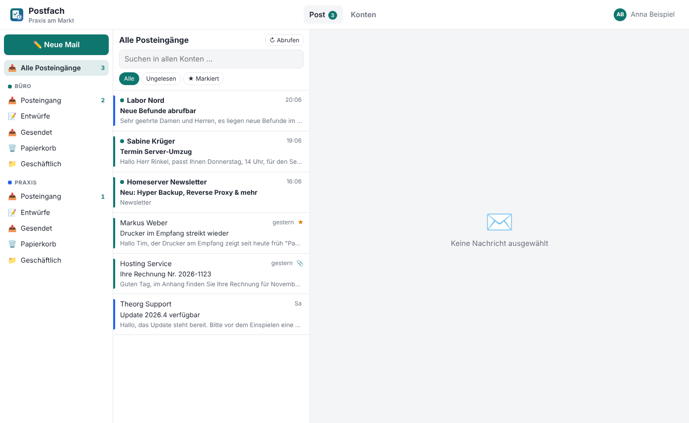
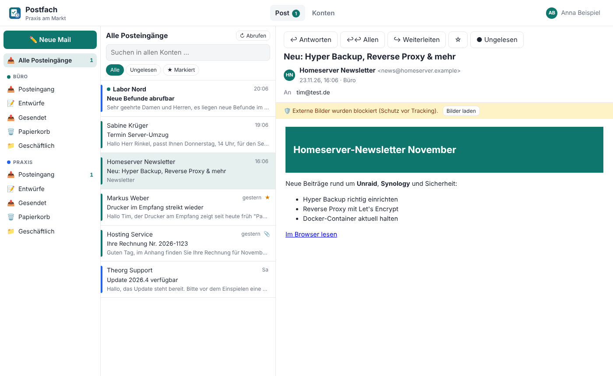
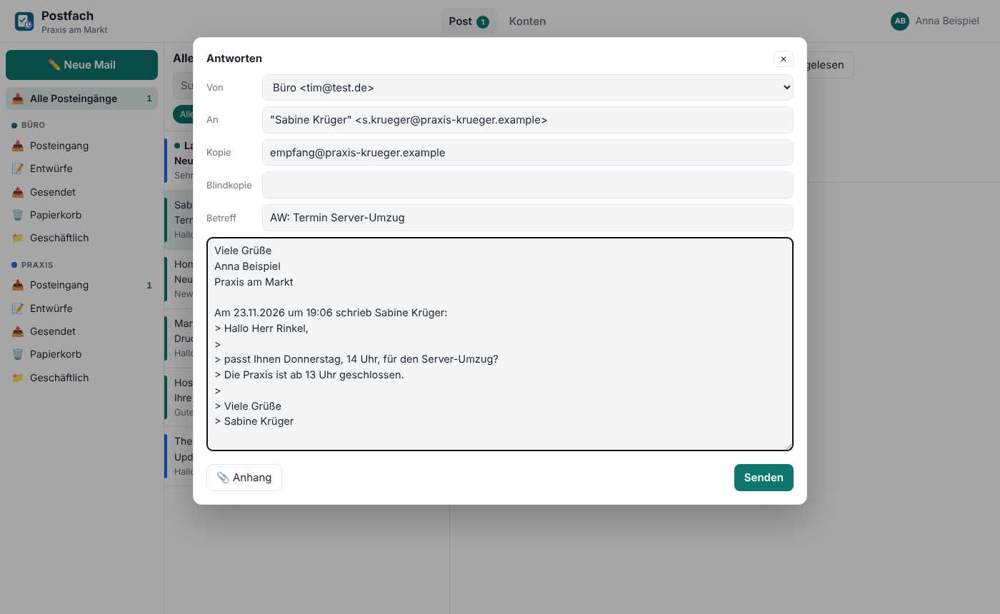
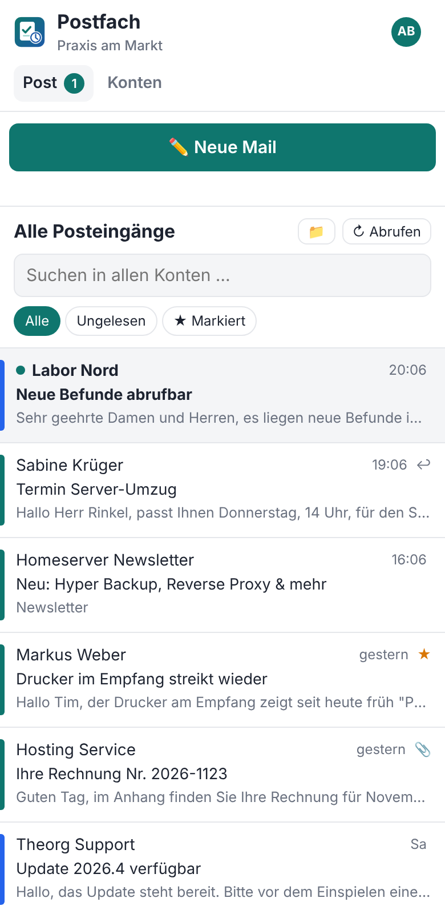
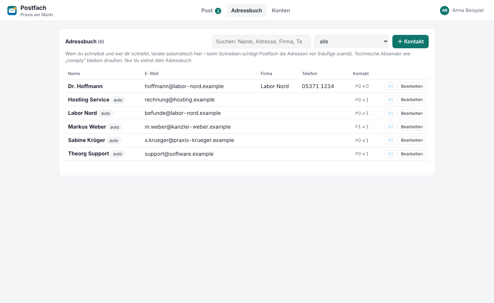
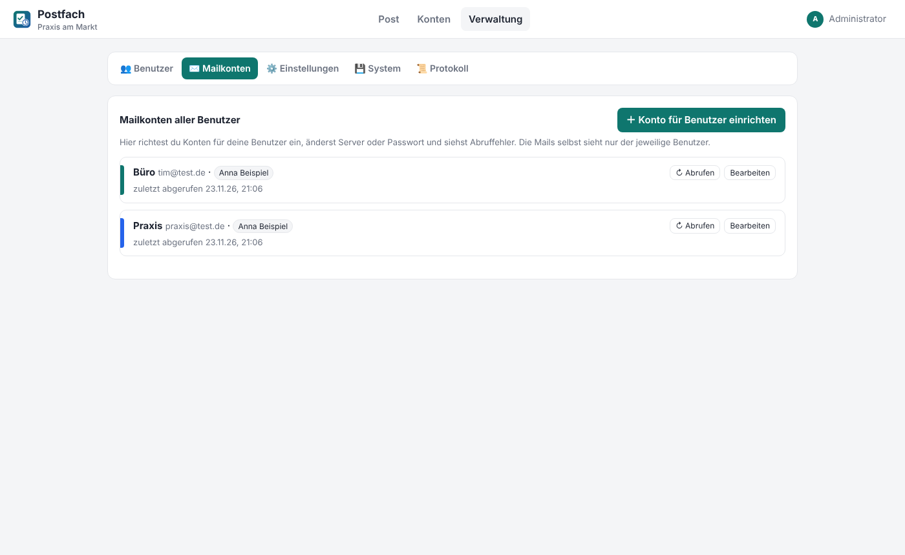
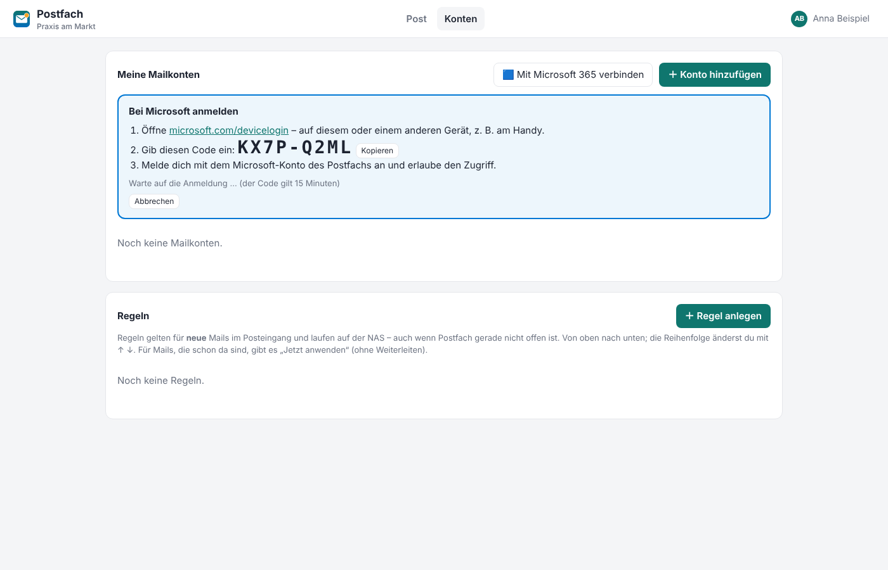
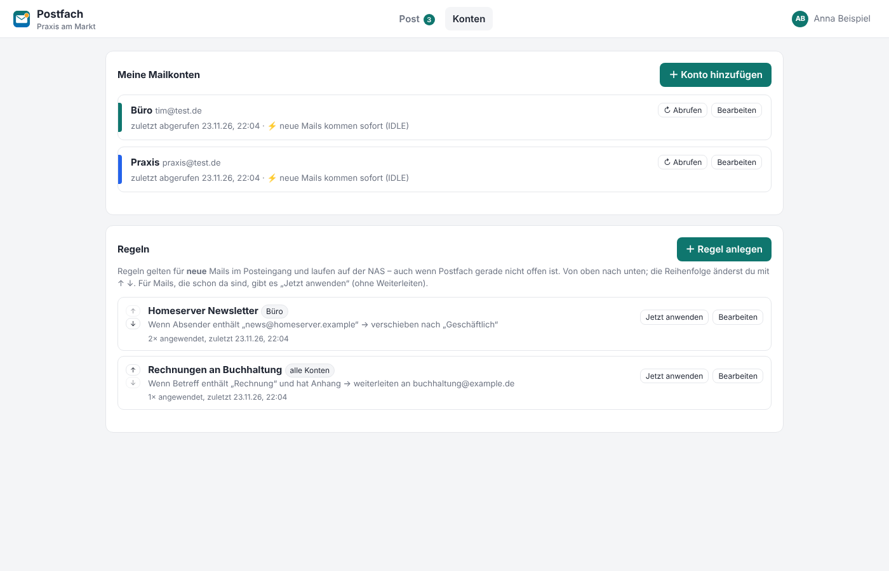

# Postfach für Synology

[](https://buymeacoffee.com/lapalutschi)

[](https://github.com/rinkelzz/postfach/actions/workflows/ci.yml)
[](https://github.com/rinkelzz/postfach/releases)
[](LICENSE)

Ein E-Mail-Programm für IMAP-Konten – als Paket auf der eigenen Synology NAS, mit eigenem Fenster in DSM.
Mehrere Benutzer, jeder mit seinen eigenen Mailkonten, alle Posteingänge in einer Liste. Wer in DSM angemeldet ist,
ist es auch hier. Die Mails bleiben auf dem Mailserver, die NAS hält nur einen Zwischenspeicher für schnelles Suchen.

> **Stand:** Version 0.5 – mit Adressbuch und Mehrfachauswahl – Lesen und Senden, neue Mails sofort (IMAP IDLE) mit Browser-Benachrichtigung,
> Löschen/Papierkorb, Verschieben, automatisch gespeicherte Entwürfe, Regeln und **Microsoft 365** (Anmeldung
> mit Code, OAuth2) – siehe [Fahrplan](#fahrplan).



## Inhalt

- [Funktionen](#funktionen)
- [Benutzer und Rechte](#benutzer-und-rechte)
- [Mailkonto einrichten](#mailkonto-einrichten)
- [Regeln](#regeln)
- [Sicherheit der Mails](#sicherheit-der-mails)
- [Fahrplan](#fahrplan)
- [Installation auf der Synology](#installation-auf-der-synology)
- [Updates über das Paket-Zentrum](#updates-über-das-paket-zentrum)
- [Datensicherung](#datensicherung)
- [Von unterwegs erreichbar machen (Reverse Proxy)](#von-unterwegs-erreichbar-machen-reverse-proxy)
- [Port ändern](#port-ändern)
- [Entwicklung](#entwicklung)
- [English](#english)

## Funktionen

- **IMAP-Konten abrufen** – beliebig viele pro Benutzer, mit SSL/TLS oder STARTTLS. Neue Mails im Posteingang kommen
  **sofort** (IMAP IDLE), alle Ordner werden zusätzlich regelmäßig abgeglichen (Standard alle 5 Minuten, einstellbar).
- **Browser-Benachrichtigung** bei neuer Mail (🔔 über der Liste), solange Postfach in einem Tab oder im DSM-Fenster offen ist.
- **Gemeinsamer Posteingang**: alle Posteingänge in einer Liste, jedes Konto mit eigener Farbe. Daneben alle Ordner
  der Konten (Gesendet, Entwürfe, Papierkorb, eigene Ordner – auch mit Umlauten).
- **Lesen**: Text- und HTML-Mails, Anhänge herunterladen, eingebettete Bilder, als gelesen/ungelesen und mit Stern
  markieren – die Markierungen landen auch am Mailserver, sind also in Outlook oder am Handy genauso zu sehen.
- **Aufräumen**: Löschen in den Papierkorb (Taste Entf), dort endgültig; Verschieben in andere Ordner – auch für
  **mehrere Mails auf einmal** (Häkchen, Umschalt-Klick für einen Bereich), dazu gelesen/ungelesen.
- **Adressbuch** je Benutzer: sammelt automatisch, wem man schreibt und wer einem schreibt (ohne noreply & Co.), von Hand
  ergänzbar (Firma, Telefon, Notiz). Beim Schreiben schlägt Postfach passende Adressen vor – häufige zuerst.
- **Entwürfe** werden beim Schreiben alle 30 Sekunden im Entwürfe-Ordner gespeichert – auch in Outlook oder am Handy
  sichtbar – und lassen sich später weiter bearbeiten.
- **Schreiben**: neue Mail, Antworten, Allen antworten, Weiterleiten (mit den Original-Anhängen, einzeln abwählbar),
  eigene Anhänge bis 25 MB, Kopie und Blindkopie, Signatur pro Konto. Gesendete Mails werden im „Gesendet“-Ordner
  am Server abgelegt (bei Gmail und Microsoft 365 macht das der Server selbst).
- **Suche** über alle Konten: Betreff, Absender, Empfänger und Text. Filter „Ungelesen“ und „Markiert“.
- **Zwischenspeicher**: Die letzten 90 Tage (pro Konto einstellbar) liegen auf der NAS – Kopfzeilen sofort, Inhalte
  werden im Hintergrund nachgeladen, Anhänge erst beim Herunterladen vom Server geholt. Der Server bleibt führend:
  was dort gelöscht wird, verschwindet beim nächsten Abruf auch hier.
- **Server-Vorschläge** für bekannte Anbieter (Gmail, GMX, WEB.DE, Telekom, IONOS, STRATO, Posteo, mailbox.org,
  iCloud, Yahoo, freenet) mit Hinweisen, z. B. dass Gmail ein App-Passwort braucht. **Verbindungstest** vor dem Speichern.
- **Handy und Desktop**: Auf dem Handy erst die Liste, dann die Mail.
- Wie bei allen meinen Synology-Apps: **Single Sign-on** im DSM-Fenster, Anmeldung mit DSM-Konto (inkl. 2FA) oder
  eigenem Konto, Firmenname und Logo, vier Designs (Klassisch, Synology DSM, Dunkel, Warm & groß), nächtliche
  Datensicherung, Updates übers Paket-Zentrum, Änderungsprotokoll, Port änderbar.

| Lesen (HTML, externe Bilder blockiert) | Antworten | Handy |
|---|---|---|
|  |  |  |



## Benutzer und Rechte

- **Jeder Benutzer sieht nur seine eigenen Mailkonten.** DSM-Benutzer werden beim ersten Öffnen automatisch angelegt
  (abschaltbar), weitere Benutzer legt der Admin unter **Verwaltung → Benutzer** an.
- **Admins** richten unter **Verwaltung → Mailkonten** Konten für ihre Benutzer ein, ändern Server und Passwort,
  sehen Abruffehler und lösen einen Abruf aus – **die Mails selbst können sie nicht lesen**. Das prüft die App bei
  jeder Anfrage, nicht nur in der Oberfläche.
- Unter **Verwaltung → Einstellungen** lässt sich abschalten, dass Benutzer selbst Konten hinzufügen. Dann richtet
  nur der Admin Konten ein, die Benutzer lesen und schreiben nur.



## Mailkonto einrichten

**Konten → Konto hinzufügen**: E-Mail-Adresse und Passwort eintragen – bei bekannten Anbietern sind die Server danach
schon ausgefüllt. Bei eigenen Domains schlägt die App `imap.<domain>` und `smtp.<domain>` vor; das passt oft, die
richtigen Server stehen sonst im Kundenmenü des Anbieters unter „E-Mail“. Mit **Verbindung testen** prüfst du
Posteingang und Postausgang, bevor du speicherst.

Besonderheiten einiger Anbieter:

- **Gmail:** braucht ein **App-Passwort** – Postfach zeigt die Anleitung mit Links an, sobald eine Gmail-Adresse
  eingetragen ist:
  1. [Bestätigung in zwei Schritten](https://myaccount.google.com/signinoptions/twosv) einschalten (ohne sie gibt es
     keine App-Passwörter).
  2. [App-Passwörter](https://myaccount.google.com/apppasswords) öffnen, Namen „Postfach“ eingeben, „Erstellen“.
  3. Das 16-stellige Passwort (ohne Leerzeichen) in Postfach als Passwort eintragen – Google zeigt es nur einmal an.
  4. Nach einer Änderung des Google-Passworts sind App-Passwörter ungültig – dann ein neues anlegen.
     Bei Google-Workspace-Konten kann der Administrator App-Passwörter sperren.
     ([Hilfe von Google](https://support.google.com/accounts/answer/185833?hl=de))
- **Yahoo, iCloud:** ebenfalls ein **App-Passwort** anlegen, das normale Passwort funktioniert nicht.
- **GMX und WEB.DE:** den Abruf per IMAP einmalig im Webmailer erlauben (Einstellungen → POP3/IMAP Abruf).
- **Telekom:** ein eigenes E-Mail-Passwort im Kundencenter anlegen.
- **Microsoft 365:** Microsoft erlaubt die Anmeldung mit Passwort per IMAP meist nicht mehr – dafür gibt es
  **Mit Microsoft 365 verbinden** (siehe unten).

### Microsoft 365

Einmalig richtet der Admin eine App-Registrierung in Entra ID ein (Anleitung direkt in der App unter
**Verwaltung → Einstellungen → Microsoft 365**, ca. 5 Minuten):

1. [entra.microsoft.com](https://entra.microsoft.com) → **App-Registrierungen → Neue Registrierung** (z. B. „Postfach“,
   nur Konten dieser Organisation, ohne Umleitungs-URI).
2. **Authentifizierung → Öffentliche Clientflows zulassen: Ja.**
3. **API-Berechtigungen:** Office 365 Exchange Online → delegiert `IMAP.AccessAsUser.All` und `SMTP.Send`, dazu
   Microsoft Graph → `offline_access`, `openid`, `email`. **Administratorzustimmung erteilen.**
4. **Anwendungs-ID (Client-ID)** und **Verzeichnis-ID** (oder Domain) in Postfach eintragen.
5. Zum Senden im Exchange Admin Center beim Postfach **Authentifiziertes SMTP** einschalten.

Danach wählt der Benutzer unter **Konten → Mit Microsoft 365 verbinden**, öffnet microsoft.com/devicelogin (auf jedem
Gerät), gibt den angezeigten Code ein und meldet sich an. Postfach braucht dafür keine https-Adresse und kein
Client-Geheimnis. Die Tokens werden verschlüsselt gespeichert und automatisch erneuert.



**Gmail** bleibt beim App-Passwort: Google lässt Apps mit Mailzugriff ohne kostenpflichtige Prüfung nur im Testmodus
laufen, dort müsste man sich alle 7 Tage neu anmelden.

## Regeln

Unter **Konten → Regeln** (oder mit **⚙ Regel** beim Lesen einer Mail) legt jeder Benutzer Regeln für **neue Mails im
Posteingang** an – zum Beispiel:

- Absender endet auf `@newsletter.de` → verschieben nach „Newsletter“
- Betreff enthält „Rechnung“ **und** hat Anhang → weiterleiten an die Buchhaltung
- Text enthält „Casino“ → in den Papierkorb

Bedingungen: Absender, Empfänger (An/Kopie), Betreff, Text, hat Anhang – „enthält“, „enthält nicht“, „ist gleich“,
„endet auf“; alle oder eine davon. Regeln laufen auf der NAS (auch wenn niemand Postfach offen hat), von oben nach unten;
„danach keine weiteren Regeln“ beendet die Auswertung. Mit **Jetzt anwenden** lässt sich eine Regel nachträglich auf den
Posteingang anwenden – mit Vorschau, und ohne Weiterleiten.

Beim Weiterleiten schützt Postfach vor Mail-Schleifen: Abwesenheitsnotizen, Rückläufer, Massenmails und schon
weitergeleitete Mails werden nicht weitergeleitet, höchstens 50 Weiterleitungen pro Konto und Stunde. Regeln sieht nur ihr
Besitzer, auch Admins nicht.



## Sicherheit der Mails

- **Passwörter der Mailkonten** müssen für IMAP/SMTP lesbar bleiben und werden deshalb **verschlüsselt** gespeichert
  (HMAC-SHA256 im Zählermodus + HMAC-Prüfsumme, nur Standardbibliothek). Der Schlüssel liegt in einer eigenen Datei
  im Paketordner (nur für den Paketbenutzer lesbar) und **nicht** in der Datenbank. Die Passwörter werden nie an den
  Browser ausgeliefert und nicht in Datensicherungen übernommen.
- **HTML-Mails** werden dreifach abgesichert: ein Filter lässt nur harmlose Tags und Attribute durch (kein Script,
  keine Formulare, keine `javascript:`-Links), die Mail wird in einem abgeschotteten Rahmen ohne Scripts angezeigt,
  und eine eigene Content-Security-Policy verbietet das Nachladen.
- **Externe Bilder sind blockiert**, bis du „Bilder laden“ klickst – so verraten Tracking-Pixel in Newslettern nicht,
  dass und wann du eine Mail geöffnet hast. Eingebettete Bilder (z. B. Logos in Signaturen) werden direkt angezeigt.
- **Anhänge** werden immer als Download ausgeliefert, nie im Browser geöffnet.
- **Verbindungen** zum Mailserver nur verschlüsselt (SSL/TLS oder STARTTLS), das Zertifikat wird geprüft.

Mehr in [SECURITY.md](SECURITY.md).

## Fahrplan

| Version | Inhalt |
|---|---|
| 0.1 | Lesen + Senden: Konten, Abruf, Ordner, gemeinsamer Posteingang, Suche, Anhänge, Antworten/Weiterleiten, Rechte für Admins |
| 0.2 | Neue Mails sofort (IMAP IDLE), Browser-Benachrichtigung, Löschen/Papierkorb, Verschieben, Entwürfe |
| 0.3 | Regeln: verschieben, weiterleiten, Papierkorb – für neue Mails, „Jetzt anwenden“ für vorhandene |
| 0.4 | Microsoft 365 per OAuth2 (Anmeldung mit Code) – Gmail bleibt beim App-Passwort |
| **0.5** | **Mehrfachauswahl (löschen, verschieben, markieren), Adressbuch mit Vorschlägen, Gmail-Anleitung** |

## Installation auf der Synology

Voraussetzung: DSM 7. Ein Paket für alle Modelle – **Intel/AMD** und **ARM** (ARMv8, ARMv7).

1. Unter [Releases](https://github.com/rinkelzz/postfach/releases) die neueste
   `postfach-<version>-0001-noarch.spk` herunterladen.
2. DSM → **Paket-Zentrum** → **Manuelle Installation** → SPK auswählen → Hinweis zu Drittanbieter-Paketen bestätigen.
3. Im Assistenten:
   - ein Passwort für den Benutzer `admin` (mindestens 8 Zeichen),
   - optional den **Firmennamen**,
   - den **Port** (Standard `8810` – nur ändern, wenn er schon belegt ist).
4. „Postfach“ erscheint im DSM-Hauptmenü. Unter **Konten** das erste Mailkonto hinzufügen.

Das Paket nutzt das Python der NAS (3.8 bis 3.13). Fehlt es, bricht die Installation mit einem Hinweis ab –
dann im Paket-Zentrum „Python 3.9“ installieren. Die Daten liegen unter `/var/packages/postfach/var/` und
bleiben bei Updates erhalten. **Beim Deinstallieren werden Benutzer und Kontoeinstellungen gelöscht** (die Mails
bleiben auf den Mailservern) – deshalb die [Datensicherung](#datensicherung) einrichten.

## Updates über das Paket-Zentrum

Die App ist ihre eigene Paketquelle – neue Releases von GitHub erscheinen im Paket-Zentrum zum Aktualisieren.
Einmalig einrichten:

1. **Paket-Zentrum → Einstellungen → Allgemein → Vertrauensebene:** „Beliebiger Herausgeber“
   (das Paket ist nicht von Synology signiert).
2. **Paket-Zentrum → Einstellungen → Paketquellen → Hinzufügen:** Name `Postfach`,
   Ort `http://127.0.0.1:8810/spk` (bei geändertem Port entsprechend – die genaue Adresse steht in der App
   unter **Verwaltung → System → Updates**).

Die App prüft etwa alle 30 Minuten (oder per „Jetzt prüfen“), lädt eine neue SPK auf die NAS und bietet sie dort an.
Die Paketquelle antwortet nur im lokalen Netz.

## Datensicherung

Die App sichert jede Nacht (Standard 2 Uhr) Benutzer, Kontoeinstellungen und Einstellungen und behält die letzten
7 Sicherungen im Paketordner. Weil DSM diesen Ordner beim Deinstallieren löscht und Hyper Backup ihn nicht erfasst,
gehört zusätzlich ein **freigegebener Ordner** dazu:

1. **Systemsteuerung → Freigegebener Ordner** → z. B. `backup` → **Bearbeiten → Berechtigungen** →
   oben **System-interner Benutzer** wählen → `postfach` **Lesen/Schreiben** geben.
2. In der App unter **Verwaltung → System → Datensicherung** den Ordner eintragen, z. B.
   `/volume1/backup/postfach` (die App prüft die Schreibrechte), und die Aufbewahrung in Tagen festlegen.
3. Den freigegebenen Ordner in Hyper Backup aufnehmen.

Nicht in der Sicherung: die **Mails** (sie liegen am Mailserver und werden nach dem Wiederherstellen neu abgerufen)
und die **Passwörter der Mailkonten**. Auf derselben NAS bleiben die Passwörter beim Wiederherstellen erhalten; auf
einer neuen NAS trägst du sie einmal neu ein – die App sagt dir, für welche Konten.

## Von unterwegs erreichbar machen (Reverse Proxy)

Für Handy und Laptop unterwegs braucht die App eine eigene https-Adresse, z. B. `https://mail.meinedomain.de`:

1. DNS-Eintrag für die Subdomain auf die NAS zeigen lassen (z. B. CNAME auf die DDNS-Adresse).
2. **Systemsteuerung → Sicherheit → Zertifikat**: Let's-Encrypt-Zertifikat für die Subdomain.
3. **Systemsteuerung → Anmeldeportal → Erweitert → Reverse Proxy**: Quelle `HTTPS mail.meinedomain.de:443`,
   Ziel `HTTP localhost:8810`.
4. In der App unter **Verwaltung → Einstellungen → Öffentliche Adresse** genau diese Adresse eintragen.

**Wichtig:** Den Port im Router **nicht** direkt freigeben – sonst laufen Passwörter und Mails unverschlüsselt durchs
Internet. Greift jemand per `http://` von außerhalb des Heimnetzes zu, zeigt die App einen Warnhinweis.

## Port ändern

Unter **Verwaltung → System → Port** einen neuen Port eintragen (1025–65535, nicht von DSM belegt). Die App prüft,
ob er frei ist, speichert ihn in `/var/packages/postfach/var/config.env` und startet sich selbst neu.
Im DSM-Fenster geht es danach einfach weiter. Anpassen musst du nur, was du selbst eingerichtet hast:
die **Paketquelle** im Paket-Zentrum und das **Ziel im Reverse Proxy**.

## Entwicklung

```bash
pip install -r requirements-dev.txt
pytest -q                                   # alle Tests
PF_DATA_DIR=./data python -m app.main       # startet auf http://localhost:8810
```

Beim ersten Start ohne `PF_ADMIN_PASSWORD` steht das Admin-Passwort in `data/ERSTES_ADMIN_PASSWORT.txt`.
Die SPK baut `./synology/build_spk.sh` (lädt die Abhängigkeiten für Python 3.8–3.13 und alle Prozessoren von PyPI).

- **Technik:** Python + FastAPI + SQLite, statisches HTML/CSS/JS ohne Build-Schritt, keine nativen Bibliotheken.
  IMAP und SMTP über die Standardbibliothek (`imaplib`, `smtplib`, `email`).
- **Tests** gegen einen nachgebauten IMAP-Server laufen bei jedem Push auf Python 3.8 und 3.13. Zusätzlich gibt es
  einen Test gegen einen echten IMAP-Server (z. B. Dovecot):
  `PF_TEST_IMAP="localhost:993:ssl:benutzer:passwort" pytest tests/test_imap_real.py`
- **Datenbank-Migrationen** über `PRAGMA user_version` in `app/db.py`: Neue Tabellen und Spalten kommen immer als
  neuer, nummerierter Schritt dazu; jeder Schritt läuft in einer eigenen Transaktion.
- **Release:** Version in `app/__init__.py` und `CHANGELOG.md` eintragen, pushen, dann
  **Actions → Release → Run workflow** – baut die SPK und legt das GitHub-Release an.

## Lizenz

[MIT](LICENSE) – frei nutzbar, auch kommerziell. Gefällt dir die App? [Spendier mir einen Kaffee ☕](https://buymeacoffee.com/lapalutschi)

## English

**Postfach** ("mailbox") is a self-hosted webmail client for IMAP accounts as a package for Synology NAS (DSM 7), in
its own DSM window with single sign-on for DSM users. The user interface is German.

- Multiple users, each with their own IMAP accounts; unified inbox across accounts, all server folders, search,
  read/unread and flags synced back to the server.
- Reply, reply all and forward (with original attachments), own attachments up to 25 MB, per-account signature;
  sent mails are stored in the server's Sent folder.
- The server stays authoritative: the NAS caches the last 90 days (configurable) for fast listing and search.
- Admins set up accounts for their users but cannot read their mail.
- Account passwords are encrypted at rest (stdlib only, key file outside the database) and never included in backups.
  HTML mail is sanitized, shown in a sandboxed iframe with its own CSP, and remote images are blocked until you allow them.
- One noarch package for Intel/AMD and ARM, no native libraries; uses the NAS's Python 3.8–3.13. Nightly backups,
  updates through Package Center, four themes, audit log, configurable port.
- New mail arrives instantly via IMAP IDLE with browser notifications; delete to trash, move, auto-saved drafts.
- Server-side rules for new inbox mail (move, forward, trash) with mail-loop protection.
- Multi-select (delete, move, mark read), per-user address book with autocomplete.
- Microsoft 365 via OAuth2 device-code sign-in (XOAUTH2 for IMAP and SMTP), using the customer's own Entra app registration.
